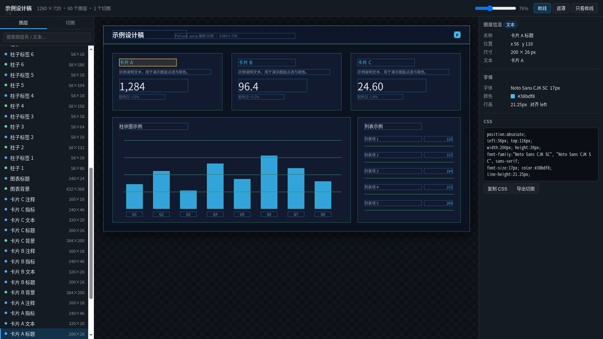

# pxpull — 在 Linux 上打开 / 解析 PxCook .pxcp 设计文件

PxCook（像素大厨）只发布 Windows 与 macOS 版本，没有 Linux 客户端。
本项目在 Linux 上**原生解析** `.pxcp` 容器，把里面的画板整图、图层元数据（位置 / 尺寸 / 颜色 /
字体 / 文本）、切图资源全部导出来，并生成一个浏览器里的「标注 + 点选」查看器，用来替代
PxCook 做后续开发。

无需 Wine、无需 Windows、无需联网，只依赖 Python ≥3.10 和 Pillow（已在 3.10 与 3.14 上实测）。



---

## 0. 安装

| 方式 | 命令 | 说明 |
| --- | --- | --- |
| 直接运行 | `python3 pxpull.py info design.pxcp` | 只需要 Pillow |
| uv（推荐） | `uv sync` → `uv run pxpull info design.pxcp` | 自动建 venv、装依赖，并生成 `pxpull` 命令 |
| pip | `pip install -e .` | 得到全局 `pxpull` 命令 |

仓库：<https://github.com/FFFengMJL/pxpull>（MIT）。本工具不通过 PyPI 分发，按上面的源码方式安装即可。

```bash
uv sync                    # 安装运行依赖 + dev 依赖（pytest / ruff）
uv run pytest              # 15 个用例，见 tests/
uv run --python 3.10 pytest   # 最低支持版本回归（需先 uv python install 3.10）
uv run ruff check .        # 静态检查
make hooks                 # 启用提交前检查（uv.lock 只允许官方 PyPI）
make lock-check            # 确认 uv.lock 与 pyproject.toml 一致
uv run pxpull --help
```

---

## 1. 快速开始

```bash
# 查看文件概要（画板尺寸、图层数、字体、资源数）
python3 pxpull.py info design.pxcp

# 一步导出：整图 + elements.json + 切图 + viewer.html（约 17 MB）
python3 pxpull.py export design.pxcp -o out/design

# 需要全部 7 档密度（d120~d640，约 36 MB）时：
python3 pxpull.py export design.pxcp -o out/design --all-densities --max-density 640

# 打开查看器（Chrome/Edge/Firefox 均可，直接 file:// 打开）
xdg-open out/design/viewer.html
```

> 没有现成设计稿时，可用仓库自带的 `examples/demo.pxcp` 代替 `design.pxcp` 试跑；下文示例里的
> `--name 卡片` 就取自它的图层名（`卡片 A 背景`、`卡片 B 标题`…）。

查看器里可以：

- 鼠标悬停高亮图层，点击查看 **坐标 / 尺寸 / 颜色 / 字体 / 行高 / 对齐**；
- 右侧直接给出可复制的 CSS；
- 「导出切图」把任意图层区域从 2x 画板图上裁下来；
- 左侧「图层」列表可搜索、双击缩放到该图层；「切图」页签列出内嵌的 17 组切图资源；
- 顶部「只看框线」把设计图隐藏，只留结构框，方便看布局。

### 其它命令

```bash
python3 pxpull.py elements design.pxcp -o elements.json --pretty   # 图层 JSON
python3 pxpull.py elements design.pxcp --csv                        # 图层 CSV
python3 pxpull.py assets   design.pxcp -o assets --largest          # 内嵌切图（多密度）
python3 pxpull.py slice    design.pxcp -o slices --all --min-area 20000   # 按图层裁图
python3 pxpull.py slice    design.pxcp -o slices --name 卡片               # 按名称/文本子串筛选
python3 pxpull.py render   design.pxcp -o preview.png --scale 2     # 结构预览（见 §5 限制）
```

参数说明用 `python3 pxpull.py <cmd> --help`。

---

## 2. .pxcp 格式（逆向结果）

小端；字符串统一是 `u32 长度 + UTF-8`；记录是 `u32 长度 + 内容`。

```
"PXCP"
u32                     版本号（本文件 399）
str                     项目名（"示例项目"）
str                     原始设计文件路径（"D:/…/design.xd"）
str                     平台（"Web" / "iOS" / "Android" …）
str                     缩放标记（"1x"）
str                     "pxv"
str                     "auto"
<opaque>                时间戳等，长度随版本变化（本文件 20 字节）
u32 36 + uuid           生成 GUID
u32 + JSON              画板文档（artboard / width / height / elements[391] …）
u32 + PNG               画板缩略图       288×162
u32 + PNG               画板整图（retina）3840×2160
u32 + 资源库             所有切图（见下）
u32 0                   结束符
```

资源库：

```
u8 1, u16 hash, u16 count
count × {
    u32 len, u8 1, u16 36, guid(36B), u16 namelen, name, u16 nchild
    nchild × {
        u32 len, u8 1, u16 namelen, name(d120…d640), u16 fmtlen, fmt(png|svg),
        u32 size, data
    }
}
```

- `group.guid` 等于元素 `baseInfo.id`，`group.name` 等于图层名；
- 每组分 7 档：`d120/d160/d240/d320/d480/d640`（1.2x～6.4x 的 PNG）+ 一张 `svg`；
- 元素 JSON 里每条记录含 `baseInfo / rectInfo / vectorInfo / fontInfo / effectInfo`，
  颜色是 `0xAARRGGBB`，填充 `type=1` 为纯色、`type=0` 为线性渐变，`radius` 顺序为
  `[左上, 右上, 右下, 左下]`。

### 文件里有什么、没有什么

| 有 | 没有 |
| --- | --- |
| 3840×2160 画板整图（精确渲染结果） | 矢量路径数据（贝塞尔曲线） |
| 每个图层的矩形框、颜色、渐变、描边、圆角、阴影 | 图层的父子层级 / 编组关系 |
| 全部文本内容、字体名、字号、行高、对齐、颜色 | 文字转曲后的字形轮廓 |
| 17 组切图（图标、插图、边框、装饰…，含 SVG） | 外链图片（如设计里的背景照片） |

> 结论：`.pxcp` 本质是「位图 + 标注元数据 + 切图」，不是完整矢量文档。
> 所以做开发时以 **画板整图** 为准，元数据用来量尺寸、取色、抄字。

---

## 3. 实测样本

用一份 1920×1080 的 Web 大屏设计稿做过完整验证（文件与素材不外附）：

- 画板：1920×1080，retina 2x，391 个图层
- 图层：文本 128、形状 197、图片 16、容器 50（另有 1 个标题图层带切图）
- 字体：HarmonyOS Sans SC / PingFang SC / Impact / DIN / HelveticaNeue
- 字号：14 / 16 / 18 / 20 / 36
- 切图：17 组（图标、插图、边框、装饰等，每组 6 档 PNG + 1 张 SVG）
- 外链图片：背景照片没有随文件打包，同目录的一张背景图（1920×1080）就是它；
  设计方另外导出的 1x 整图与内嵌 2x 整图基本一致（缩放后平均像素差 ~2.5/255）。

仓库里的 `examples/demo.pxcp` 是合成示例（无任何真实项目内容），用来跑通流程与截图。

---

## 4. Linux 上怎么打开 .pxcp

| 方案 | 前提 | 局限 |
| --- | --- | --- |
| 官方客户端 | 官网只有 Windows 7–11 x64 与 macOS 10.12+ | 没有 Linux 版，需要额外的 Windows 或 macOS 环境 |
| Wine / CrossOver / PlayOnLinux | 能安装并启动安装包 | 老版（Adobe AIR）有成功案例；新版在字体、拖拽、登录、云同步上依赖运行环境 |
| 虚拟机 / 远程 Windows | 有镜像或可远程的主机 | 资源占用与授权成本；适合需要编辑设计稿的场合 |
| 本项目（原生解析） | Python ≥3.10 + Pillow | 只读取已有内容（整图、元数据、切图），不能编辑或回写设计稿 |

几种方式可以并存：需要改设计稿时用官方客户端；只在 Linux 上查看标注、取切图、量尺寸时，可以直接解析文件。差别在于是否要多一台机器，以及是否需要编辑能力。

---

## 5. 已知限制

- `render` 是**结构预览**：`.pxcp` 不存矢量路径，渐变文字（如大数字）、折线图曲线、
  装饰路径只能还原成外接矩形，所以渲染结果与设计稿不等价。看图请用 `viewer`/`artboard`。
- 字体按 fontconfig 替换（HarmonyOS Sans SC → Noto Sans CJK SC），文本宽度会有 1–2px 偏差。
- 如果同一目录有与某个空图层尺寸匹配的图片，`render` 会自动把它当作外链图片填进去
  （同目录的背景图就是这样被用上的），可用 `--fill-image` 显式指定。
  匹配条件：图片尺寸覆盖元素、不超过 3 倍、宽高比误差 <0.5%，且每张图只用一次；
  命中/未命中都会在 `render` 输出里打印。实测：带背景图时渲染结果与 2x 画板整图
  的平均差从 12.61/21.44/24.67 降到 11.82/20.44/23.26（15% 的像素发生变化）。
- 画板背景图会按「背景色矩形 → 背景图 → 正文」的顺序重排（`.pxcp` 里它常被排在
  第二张背景矩形之前，直接按数组顺序画会被盖住）。
- 查看器右侧面板的色值直接来自文件元数据（ARGB），不受显示器色彩配置影响；用屏幕取色器
  取画板图颜色时，结果会随系统/显示器 profile 变化。`docs/viewer.png` 已统一转为 sRGB。
- 资源库、头部字段的布局在不同 PxCook 版本间可能变化；解析失败时会在 `info` 里体现
  （资源数为 0），不会影响 JSON 与整图导出。

---

## 6. 文件

```
pxpull.py         解析器 + CLI（info/assets/elements/render/viewer/slice/export）
pxpull_viewer.py  查看器 HTML 生成器
pyproject.toml    打包（console script: pxpull）与 pytest / ruff 配置
uv.lock           依赖锁文件（uv）
tests/            单元测试：conftest.py 合成最小 .pxcp，test_pxpull.py 15 个用例
Makefile          make test / lint / info / export / hooks / lock-check
scripts/          check-lock.sh：依赖锁文件只允许官方 PyPI
.githooks/        pre-commit：提交前检查，make hooks 启用
docs/viewer.png   查看器截图
examples/         合成示例 demo.pxcp 与生成脚本 make_demo.py
out/              导出目录（gitignore）
  ├─ artboard@2x.png     3840×2160 画板整图
  ├─ thumbnail.png       缩略图
  ├─ elements.json       391 个图层（含 CSS 所需字段）
  ├─ viewer.html         可点选的查看器
  └─ assets/             17 组切图（默认每组最高可用档 ≤3.2x + SVG；加 --all-densities 导出全部档位）
```

依赖：Python ≥ 3.10、Pillow（`pip install pillow`）。渲染另需 fontconfig（`fc-match`）。

---

## 7. 开发时怎么用

### 查某个元素的尺寸 / 颜色 / 字体

```bash
python3 - <<'PY'
import json
d = json.load(open("out/design/elements.json"))
for e in d["elements"]:
    if e["kind"] == "text" and "ABC" in (e.get("text") or ""):
        print(e["name"], e["x"], e["y"], e["width"], e["height"],
              e["font"]["size"], e["font"]["color"])
PY
```

### 量一个区域

在 `viewer.html` 里双击左侧图层 → 自动缩放到该图层；右侧显示 x/y/w/h、圆角、描边、
阴影和可直接复制的 CSS。鼠标在画布上移动时，右上角实时显示设计坐标。

### 取某块图

```bash
python3 pxpull.py slice design.pxcp -o slices --name 卡片
python3 pxpull.py slice design.pxcp -o slices --index 3,4,5
```

裁切源是 2x 画板整图，所以导出的图比 1x 设计稿清晰一倍。

### 三个使用原则

1. **坐标直接可用**：元素坐标就是 1920×1080 设计稿坐标，`position:absolute` 直接用；
2. **颜色**：`elements.json` 里是 `0xAARRGGBB`，一般 alpha=ff，取后 6 位即可；
3. **复杂装饰**（大数字渐变、折线、光效路径）：.pxcp 没有路径数据，用 2x 整图裁切，
   或按视觉用 CSS/SVG 重绘，不要指望 `render` 能还原。

---

## 8. 关于生成方式

本仓库的代码、测试与文档由 AI 辅助生成，并经人工审阅与实测（15 个用例、真实 `.pxcp` 设计稿）。
AI 产出仍可能包含错误或过时信息；使用前请按自己的场景评估，发现问题欢迎提 issue。

---

## 9. 许可证

MIT，见 [LICENSE](LICENSE)（版权人：FFFengMJL）。如需改为其他许可证或版权人，
请同时更新 `pyproject.toml` 的 `license` / `authors` 字段。

---

[](https://github.com/deepseek-ai/deepseek-harness)
